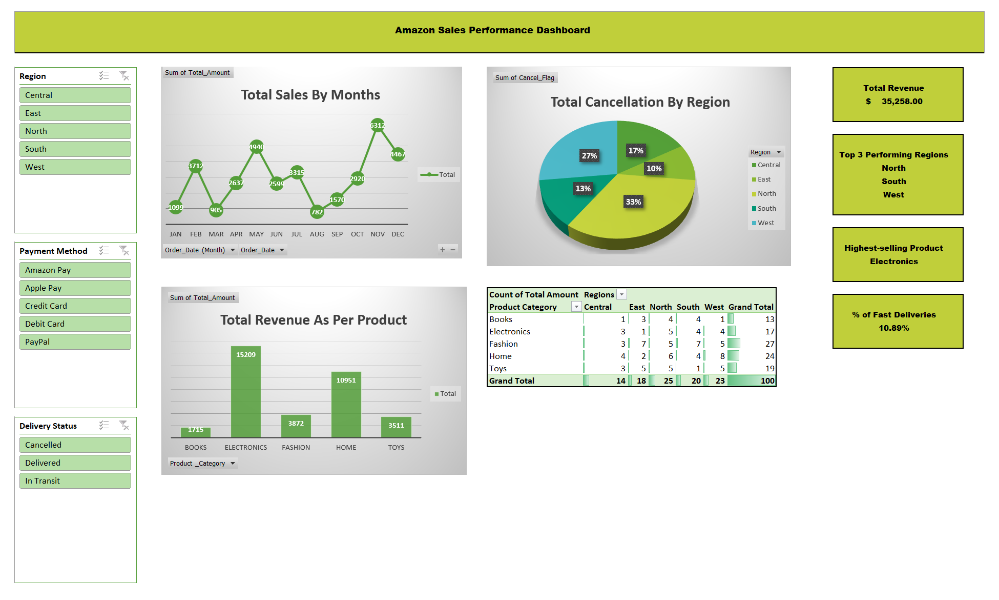

# Amazon Sales Performance Dashboard in Excel

## Project
For my first Excel analytics project, I explored 100 orders from a course
dataset. I wanted to understand which product categories received the most
orders and how order volume varied across five regions.

## Approach
I used Excel PivotTables to compare order counts by category and region,
then presented the results with charts and a dashboard.

## Findings
- Fashion led with 27 orders, followed by Home with 24. Together, these
  categories accounted for 51 of the 100 orders.
- North recorded 25 orders, compared with 14 in Central.
- At the time captured in the dataset, 34 orders were delivered,
  36 were in transit and 30 were cancelled.

## What I learned
“Best-selling” can mean the most orders, the most units or the highest
sales value. Choosing the measure first makes the dashboard easier to interpret.
